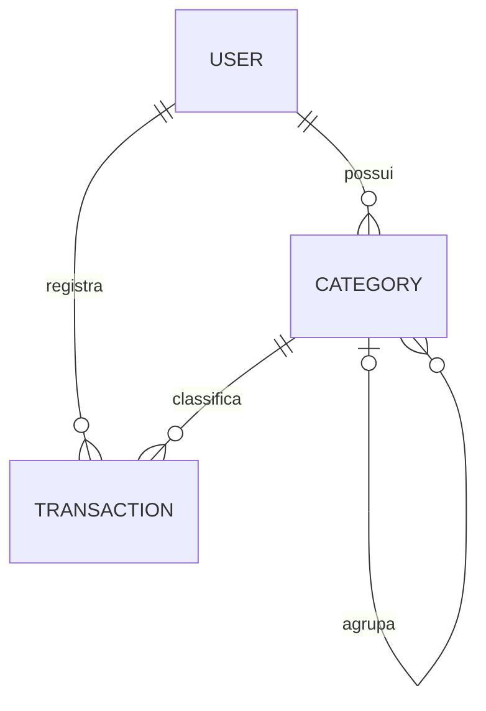

# Backlog inicial — BudgetWallet

Este backlog é uma proposta evolutiva. O repositório contém o README e as pastas `frontend`, `src` e `prisma`, ainda sem implementação versionada. Vamos detalhar apenas o necessário para entregar e validar o primeiro fluxo; as próximas funcionalidades serão refinadas conforme aprendermos com o uso.

## Objetivo da primeira entrega

**Uma pessoa consegue fazer login, acessar o Dashboard, registrar uma receita ou despesa, classificá-la e consultar suas movimentações e o resultado do mês.**

A navegação definida e o esboço das telas estão em [Fluxo do usuário](USER-FLOW.md): Login → Dashboard, com outras três abas — Receitas e Despesas, Investimentos e Previsões / Acompanhamento mensal dia a dia. As duas últimas serão implementadas em incrementos posteriores.

Definições e recorte inicial (propostas restantes indicadas em cada documento):

- Valores em reais (BRL), exibidos com R$ e precisão de centavos, confirmado pelo usuário.
- Lançamentos manuais já realizados, sem parcelas ou agendamentos.
- Uma categoria por lançamento.
- Categorias editáveis, com subcategorias e opções iniciais sugeridas em [Regras de negócio](BUSINESS-RULES.md). O mesmo documento detalha a proposta do calendário, meta de economia e redistribuição do orçamento diário para incremento posterior.
- O resultado mensal é receitas menos despesas do período; não representa saldo bancário.
- O primeiro incremento usa acesso demonstrativo: e-mail ou username e senha preenchidos permitem entrar, sem validar credenciais. Autenticação real, cadastro e recuperação na própria página de login ficam para um incremento posterior, antes de uso real.

## Como trabalhar com este backlog

- Priorizar de cima para baixo, ajustando a ordem quando houver aprendizado ou dependências.
- Puxar poucas tarefas por vez e entregar incrementos demonstráveis. Modelagem, código e testes evoluem juntos.
- Usar os estados: A refinar → Pronto → Em andamento → Em revisão → Concluído.
- Considerar um item pronto para desenvolvimento quando objetivo, critérios de aceite e dependências estiverem claros.
- Fazer uma revisão curta após cada incremento: demonstrar, colher feedback e reordenar o backlog.
- Registrar decisões relevantes em ADRs curtos: contexto, decisão, consequências e motivo para reconsiderá-la.
- Os tamanhos P/M são relativos e provisórios, não estimativas de prazo. Dividir itens que ficarem grandes durante o refinamento.

## Fila inicial priorizada

BW-01 está **Concluído**; os demais itens permanecem **A refinar**. As dependências abaixo indicam a ordem técnica, sem exigir uma fase completa de documentação antes de programar. BW-10 cobre o acesso demonstrativo inicial; BW-09 e BW-11 cobrem o acesso real posterior. Os IDs existentes foram preservados.

| ID | Item | Tamanho | Depende de | Incremento |
| --- | --- | --- | --- | --- |
| BW-01 | Alinhar o primeiro fluxo e suas regras | P | — | 1 |
| BW-02 | Preparar uma base executável e verificável | M | BW-01 | 1 |
| BW-03 | Modelar e persistir o mínimo do domínio | M | BW-01, BW-02 | 1 |
| BW-10 | Criar a entrada demonstrativa e navegação | P | BW-02 | 1 |
| BW-04 | Registrar e listar movimentações de ponta a ponta | M | BW-03 | 1 |
| BW-12 | Gerenciar categorias e subcategorias | M | BW-03, BW-04 | 2 |
| BW-05 | Consultar o resultado de um mês | P | BW-04 | 2 |
| BW-06 | Corrigir e excluir lançamentos | P | BW-04 | 2 |
| BW-07 | Validar a experiência e refinar a próxima entrega | P | BW-05, BW-06 | 2 |
| BW-08 | Validar a estratégia de persistência e publicação | P | BW-02 | Antes de publicar |
| BW-09 | Autenticar usuários e proteger seus dados | M | BW-03, BW-04, BW-10 | Posterior, antes de uso real |
| BW-11 | Cadastrar conta e recuperar senha na página de login | M | BW-09 | Posterior, antes de uso real |
| BW-13 | Planejar o mês e visualizar o calendário | A estimar | BW-05, BW-06 | Posterior |
| BW-14 | Redistribuir o orçamento entre dias | A estimar | BW-13 | Posterior |

### BW-01 — Alinhar o primeiro fluxo e suas regras

**Estado:** Concluído em 17/11/2026. Fluxo e regras iniciais registrados em [USER-FLOW.md](USER-FLOW.md), com categorias e planejamento aprovados pelo usuário nesta conversa. O encerramento é de definição do produto, sem indicar código implementado. Refinamentos do calendário permanecem em BW-13/BW-14.

**Objetivo:** reduzir dúvidas que mudariam a primeira implementação.

**Trabalho:** desenhar um fluxo simples de cadastro e consulta; produzir um esboço de tela de baixa fidelidade; validar as hipóteses acima com a equipe.

**Critérios de aceite:**

- O fluxo descreve os campos obrigatórios, o sucesso e os erros mais comuns.
- Ficam definidos: data do lançamento, precisão monetária, categorias iniciais e tratamento de datas futuras.
- Há exemplos concretos: receita de R$ 2.000,00, despesa de R$ 150,50 e resultado de R$ 1.849,50.
- O escopo da demonstração local e a necessidade de autenticação antes de uso real estão explícitos.

### BW-02 — Preparar uma base executável e verificável

**Objetivo:** permitir que qualquer integrante execute e altere o projeto.

**Trabalho:** configurar TypeScript, React, backend Node.js, Prisma e scripts de desenvolvimento; manter a separação inicial sugerida abaixo; registrar a decisão do framework de backend conforme as necessidades do primeiro fluxo.

**Critérios de aceite:**

- O README explica instalação, configuração, criação do banco e execução a partir de um clone limpo.
- Há arquivo de exemplo de variáveis de ambiente sem segredos e regras para ignorar credenciais e banco local.
- Existem comandos para lint, verificação de tipos, testes e build.
- Uma CI executa as verificações automatizadas pertinentes em pull requests.
- O frontend consegue consultar uma rota simples do backend; credenciais e acesso ao banco ficam no servidor.

### BW-03 — Modelar e persistir o mínimo do domínio

**Objetivo:** sustentar o primeiro caso de uso sem antecipar investimentos, recorrências ou IA.

**Trabalho:** revisar o modelo proposto abaixo; implementar o schema Prisma, a primeira migration e um seed de desenvolvimento com dados fictícios.

**Critérios de aceite:**

- A migration cria um banco vazio corretamente e o seed pode ser repetido sem duplicar os dados iniciais.
- As relações, campos obrigatórios e índices necessários à consulta mensal estão definidos.
- Valores monetários são armazenados como inteiros em centavos; o limite aceito é documentado e validado.
- O lançamento só pode usar uma categoria pertencente ao mesmo usuário e compatível com seu tipo.
- Testes de integração verificam persistência, vínculos e rejeição de dados inválidos.
- Uma decisão curta registra as convenções de dinheiro, datas e exclusão de registros relacionados.

### BW-04 — Registrar e listar movimentações de ponta a ponta

**História:** como usuário, quero registrar e consultar receitas e despesas para acompanhar minhas movimentações.

**Trabalho:** implementar contrato HTTP mínimo, validação no servidor, formulário React e listagem. Usar categorias e subcategorias do seed nesta entrega; a edição e criação pelo usuário entram em BW-12.

**Critérios de aceite:**

- É possível informar tipo, valor positivo, data e categoria; a descrição é opcional.
- A interface converte o valor monetário para centavos sem introduzir arredondamentos indevidos.
- O servidor rejeita valores inválidos e categorias incompatíveis, mesmo sem as validações do formulário.
- Ao salvar, o lançamento aparece na lista e permanece após recarregar a página.
- A lista tem ordenação determinística por data e desempate por identificador, além de um limite de resultados ou paginação.
- Há estados de carregamento, lista vazia, erro e confirmação de sucesso; o envio fica bloqueado enquanto a requisição está em andamento.
- Um teste do fluxo principal cobre cadastro e consulta; testes de integração cobrem as rejeições relevantes.

### BW-05 — Consultar o resultado de um mês

**História:** como usuário, quero consultar receitas, despesas e resultado do mês para entender meu período financeiro.

**Critérios de aceite:**

- Um seletor de mês filtra a lista e os totais pelo mesmo período.
- A consulta inclui o primeiro dia do mês e exclui o primeiro dia do mês seguinte.
- Os totais consideram todos os lançamentos do período, independentemente da paginação.
- O resultado é receitas menos despesas, calculado em centavos; mês vazio apresenta zero.
- Testes cobrem virada de mês/ano, mês vazio e resultado negativo.

### BW-06 — Corrigir e excluir lançamentos

**História:** como usuário, quero corrigir ou remover um registro incorreto para manter meus dados consistentes.

**Critérios de aceite:**

- É possível editar os campos cadastrados, com as mesmas validações da criação.
- A exclusão exige confirmação clara na interface.
- Lista e totais refletem a alteração; erros não são apresentados como sucesso.
- A política inicial de exclusão é documentada; uma trilha de auditoria completa não é requisito desta entrega.

### BW-07 — Validar a experiência e refinar a próxima entrega

**Objetivo:** escolher os próximos passos a partir de evidências de uso.

**Critérios de aceite:**

- A equipe realiza uma demonstração com dados fictícios: registrar receita, registrar despesa, consultar mês e corrigir um lançamento.
- São verificadas navegação por teclado, rótulos dos campos, mensagens compreensíveis e uso em tela pequena.
- Dificuldades e falhas viram itens priorizados com exemplos reproduzíveis.
- A equipe escolhe o próximo objetivo e detalha somente os itens necessários para alcançá-lo.

### BW-08 — Validar a estratégia de persistência e publicação

**Objetivo:** demonstrar que a aplicação publicada preserva os dados com a arquitetura escolhida.

**Trabalho:** executar uma investigação curta antes de decidir a hospedagem definitiva. SQLite atende à proposta local; a compatibilidade da persistência com o ambiente escolhido para publicação precisa ser comprovada.

**Critérios de aceite:**

- Uma decisão registra onde rodam frontend, backend e banco, considerando a Vercel prevista no README.
- Uma prova com dados fictícios verifica persistência após reinício/redeploy e o comportamento esperado de acesso concorrente.
- Há estratégia para migrations, armazenamento de segredos, backup e restauração.
- Se a solução exigir trocar o banco ou hospedagem, a decisão e o trabalho necessário entram no backlog antes da publicação.

### BW-09 — Autenticar usuários e proteger seus dados

**Objetivo:** permitir uso real sem acesso indevido a dados financeiros.

**Trabalho:** escolher uma solução de autenticação, conectar a identidade às entidades existentes e substituir o usuário fixo de desenvolvimento.

Implementar em incremento posterior, substituindo o acesso demonstrativo de BW-10 e protegendo as rotas de BW-04 antes de uso real. O método definido é e-mail ou username e senha, com validação real de credenciais nesta etapa.

**Critérios de aceite:**

- Login e logout funcionam; rotas privadas rejeitam requisições sem autenticação.
- Login bem-sucedido abre o Dashboard; acesso à interface privada sem sessão válida e logout levam à tela de login.
- O servidor obtém o usuário da sessão validada, sem confiar em um `userId` enviado pelo cliente.
- Listagem, totais, criação, edição e exclusão são restritos ao proprietário dos dados.
- Testes com dois usuários provam que um não consegue consultar ou alterar registros e categorias do outro, inclusive usando IDs conhecidos.
- O usuário fixo de desenvolvimento não fica disponível no ambiente de uso real.

### BW-10 — Criar a entrada demonstrativa e navegação

**Objetivo:** validar o fluxo Login → Dashboard sem depender da autenticação real.

**Critérios de aceite:**

- A página apresenta E-mail ou username, Senha e Entrar; qualquer identificador e senha não vazios permitem entrar no Dashboard.
- O identificador aceita username sem exigir formato de e-mail; a senha fica visualmente oculta e não é persistida nem registrada em logs.
- Campos vazios mostram mensagem de validação. O modo demonstrativo usa apenas dados fictícios e um usuário local de demonstração, sem criar contas a cada entrada.
- A navegação disponibiliza Dashboard e as três abas definidas; funcionalidades futuras ficam identificadas como “Em breve”.
- Sair retorna ao login e limpa o estado demonstrativo; acesso direto antes de entrar retorna ao login, sem apresentar esse controle como autenticação real.
- O modo demonstrativo fica restrito ao desenvolvimento local. Cadastro e recuperação ainda não possuem ações funcionais.

### BW-11 — Cadastrar conta e recuperar senha na página de login

**Objetivo:** permitir criação de conta e recuperação de acesso na mesma página de entrada, em incremento posterior.

**Critérios de aceite iniciais, a refinar antes da implementação:**

- “Criar conta” e “Esqueci minha senha” abrem seus respectivos formulários na própria página, com opção de voltar ao login.
- O cadastro permite definir e-mail, username e senha; unicidade e normalização de identificadores são especificadas e validadas no servidor.
- A recuperação usa o e-mail da conta e um mecanismo de redefinição com validade limitada e uso único; não revela se uma conta existe nem expõe a senha anterior.
- Regras de senha, verificação de e-mail, envio de mensagens e armazenamento seguro de credenciais são definidas no refinamento, com testes dos fluxos de sucesso e falha.

### BW-12 — Gerenciar categorias e subcategorias

**Objetivo:** permitir criar e editar classificações na área de Receitas e Despesas.

**Critérios de aceite propostos:**

- Criar categorias e subcategorias, renomear e arquivar, mantendo o histórico.
- Disponibilizar categorias iniciais editáveis por usuário conforme `BUSINESS-RULES.md`.
- Validar propriedade, tipo, nomes entre irmãs e ausência de ciclos; confirmar o limite inicial proposto de dois níveis antes de implementar.
- Exibir o caminho da categoria no seletor e agregar pai/filhas sem duplicar valores.
- Testar hierarquia, isolamento, duplicidade, edição e registros vinculados.

### BW-13 — Planejar o mês e visualizar o calendário

**Objetivo:** informar receitas esperadas, despesas fixas com datas e meta de economia para visualizar orçamento e gastos diários.

**Refinamento antes do desenvolvimento:** dividir este item em entregas menores de planejamento, vínculo previsto/realizado e calendário.

**Critérios iniciais propostos:**

- Separar valores previstos de realizados; vincular realização à previsão para evitar dupla contagem.
- Calcular orçamento variável e sugestão diária em centavos; permitir ajustes manuais e exibir excedentes.
- Mostrar orçamento, consumo e disponível por dia; datas futuras contêm previsões, não movimentações realizadas.
- Manter meta de economia separada de despesas e distinguir orçamento mensal de saldo bancário.
- Testar início no meio do mês, arredondamento, mês sem orçamento e alteração de valores previstos.

### BW-14 — Redistribuir o orçamento entre dias

**Objetivo:** realocar sobras ou compensar excessos nos dias restantes, conforme escolha do usuário.

**Critérios iniciais propostos:**

- Apresentar prévia e confirmação dos ajustes; política inicial ainda a validar em `BUSINESS-RULES.md`.
- Preservar o total em centavos, não gerar limites negativos e mostrar déficit que não puder ser compensado.
- Evitar reaplicar diferenças já distribuídas; tratar correções de gastos anteriores e respeitar dias encerrados.
- Testar os exemplos de R$ 40,00 e R$ 100,00 para orçamento de R$ 50,00, além do último dia do mês e divisão com resto de centavos.

## Modelo de dados inicial proposto

Este é um ponto de partida para BW-03, não um schema definitivo. A autenticação pode alterar a estrutura de `User`; não há necessidade de definir armazenamento de senhas nesta etapa.

| Entidade | Campos iniciais | Responsabilidade |
| --- | --- | --- |
| `User` | `id`, `createdAt` | Identificar o proprietário dos dados; identidade de autenticação será refinada em BW-09. |
| `Category` | `id`, `userId`, `parentId?`, `name`, `type`, `archivedAt?`, `createdAt` | Classificar lançamentos; vínculo opcional com categoria pai do mesmo usuário e tipo. |
| `Transaction` | `id`, `userId`, `categoryId`, `type`, `amountCents`, `occurredOn`, `description?`, `createdAt`, `updatedAt` | Registrar uma movimentação realizada. |



Regras propostas:

- `type` aceita `INCOME` ou `EXPENSE`; o valor é sempre positivo e o tipo determina como ele entra no resultado.
- `occurredOn` representa uma data civil, sem horário. A representação no SQLite/Prisma será definida em BW-03, mantendo o mesmo dia na entrada, armazenamento e exibição.
- `createdAt` e `updatedAt` representam instantes de auditoria técnica, distintos da data financeira.
- Categoria é obrigatória; sugestões iniciais e hierarquia estão em `BUSINESS-RULES.md`.
- Nomes normalizados são únicos por usuário, tipo e pai (incluindo categorias raiz). Validar também ciclos e a hierarquia permitida.
- A combinação proprietário/categoria e a compatibilidade de tipos precisam ser validadas no servidor; uma chave estrangeira de categoria, sozinha, não garante essas regras.
- Categorias em uso não podem ser excluídas sem reclassificação dos lançamentos. Não implementar exclusão de usuários nesta etapa.
- Considerar índice composto por `userId` e `occurredOn` para consulta por usuário e mês, além dos índices exigidos pelas relações.
- Totais mensais são derivados dos lançamentos, sem tabela de saldo nesta etapa.

## Estrutura de código inicial proposta

```text
frontend/              Aplicação React
  src/
    features/
      transactions/    Formulário, lista e integração com a API
    components/        Componentes realmente compartilhados
src/                   Backend Node.js
  modules/
    transactions/      Rotas, validação e regras de movimentações
    categories/        Consulta das categorias iniciais
  db/                  Configuração do cliente Prisma
prisma/
  schema.prisma
  migrations/
  seed.ts
docs/
  BACKLOG.md
  decisions/           Decisões técnicas curtas, criadas conforme necessário
```

Manter um monólito modular simples. Separar interface, regras e persistência onde isso facilitar entendimento e testes; criar abstrações compartilhadas somente quando houver uma necessidade concreta. A árvore acima descreve intenção, não exige criar arquivos vazios.

## Definição de concluído

Um item de implementação está concluído quando:

- Seus critérios de aceite foram atendidos e demonstrados.
- O código foi revisado por outro integrante e as verificações automatizadas pertinentes passaram.
- Regras financeiras e de acesso alteradas têm testes proporcionais ao risco.
- Mudanças de banco incluem migration versionada; configuração e instruções afetadas foram atualizadas.
- Não há segredos nem dados financeiros reais nos arquivos ou fixtures versionados.

## Próximos candidatos — ainda sem detalhamento

Reordenar esta lista após a primeira validação. Não criar agora tabelas ou serviços apenas para acomodar essas possibilidades.

| Tema | Próxima pergunta a responder |
| --- | --- |
| Despesas recorrentes e assinaturas | A recorrência gera previsão, lançamento automático ou pedido de confirmação? |
| Contas, cartões e transferências | É necessário distinguir saldo por conta e evitar contar transferências como receita? |
| Dashboards | Quais decisões não são atendidas pela lista e pelos totais mensais? |
| Investimentos | O primeiro objetivo é registrar aportes ou acompanhar valorização? |
| Previsão financeira avançada | Além do calendário e orçamento de BW-13/BW-14, quais estimativas são necessárias? |
| Agente de IA | Quais consultas ou registros ele poderá propor, e como o usuário confirmará alterações? |
| Exportação e recuperação | Como o usuário obterá uma cópia dos próprios dados? |

**Próximo passo sugerido:** refinar e iniciar BW-02, preparando a base executável e verificável. Revisar o modelo de BW-03 ao implementar o primeiro cadastro, usando exemplos reais do fluxo e dados fictícios.
