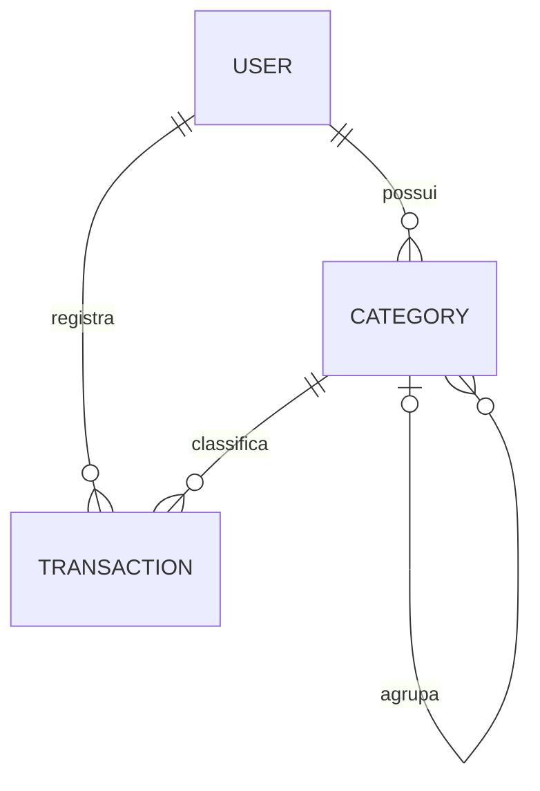

# Backlog inicial — BudgetWallet

Este backlog é evolutivo. A configuração local e as primeiras entidades e persistência foram concluídas em BW-03 para a versão inicial. Vamos detalhar apenas o necessário para entregar e validar o primeiro fluxo; as próximas funcionalidades serão refinadas conforme aprendermos com o uso.

## Objetivo da primeira entrega

**Uma pessoa consegue fazer login, acessar o Dashboard, registrar uma receita ou despesa, classificá-la e consultar suas movimentações e o resultado do mês.**

A navegação definida e o esboço das telas estão em [Fluxo do usuário](USER-FLOW.md): Login → Dashboard, com outras três abas — Receitas e Despesas, Investimentos e Previsões / Acompanhamento mensal dia a dia. As duas últimas serão implementadas em incrementos posteriores.

Definições e recorte inicial (propostas restantes indicadas em cada documento):

- Valores em reais (BRL), exibidos com R$ e precisão de centavos, confirmado pelo usuário.
- Lançamentos manuais já realizados, sem parcelas ou agendamentos.
- Uma categoria por lançamento.
- Categorias editáveis, com subcategorias e opções iniciais sugeridas em [Regras de negócio](BUSINESS-RULES.md). O mesmo documento detalha a proposta do calendário, meta de economia e redistribuição do orçamento diário para incremento posterior.
- O resultado mensal é receitas menos despesas do período; não representa saldo bancário.
- O primeiro incremento usa acesso demonstrativo: e-mail ou username e senha preenchidos permitem entrar, sem validar credenciais. Autenticação real, cadastro e recuperação na própria página de login ficam para um incremento posterior, antes de uso real.

## Como trabalhar com este backlog

- Priorizar de cima para baixo, ajustando a ordem quando houver aprendizado ou dependências.
- Puxar poucas tarefas por vez e entregar incrementos demonstráveis. Modelagem, código e testes evoluem juntos.
- Usar os estados: A refinar → Pronto → Em andamento → Em revisão → Concluído.
- Considerar um item pronto para desenvolvimento quando objetivo, critérios de aceite e dependências estiverem claros.
- Fazer uma revisão curta após cada incremento: demonstrar, colher feedback e reordenar o backlog.
- Registrar decisões relevantes em ADRs curtos: contexto, decisão, consequências e motivo para reconsiderá-la.
- Os tamanhos P/M são relativos e provisórios, não estimativas de prazo. Dividir itens que ficarem grandes durante o refinamento.

## Fila inicial priorizada

BW-01, BW-02 e BW-03 estão **Concluídos** para a versão inicial; os demais itens seguem os estados indicados em suas seções. Por decisão do usuário, a sequência passa a ser ambiente local → classes, ORM e testes → aplicação web e automação de qualidade. BW-15 e BW-16 recebem o trabalho adiado de BW-02. BW-10 cobre o acesso demonstrativo inicial; BW-09 e BW-11 cobrem o acesso real posterior. Os IDs existentes foram preservados.

| ID | Item | Tamanho | Depende de | Incremento |
| --- | --- | --- | --- | --- |
| BW-01 | Alinhar o primeiro fluxo e suas regras | P | — | 1 |
| BW-02 | Configurar ferramentas locais e executor de testes | P | BW-01 | 1 |
| BW-03 | Criar classes iniciais, mapeamento ORM e testes | M | BW-01, BW-02 | 1 |
| BW-15 | Preparar e integrar frontend e backend | M | BW-03 | 1, após domínio e persistência |
| BW-16 | Configurar lint e CI | P | BW-15 | 1, após aplicação executável |
| BW-10 | Criar a entrada demonstrativa e navegação | P | BW-15 | 1 |
| BW-04 | Registrar e listar movimentações de ponta a ponta | M | BW-03, BW-15 | 1 |
| BW-12 | Gerenciar categorias e subcategorias | M | BW-03, BW-04 | 2 |
| BW-05 | Consultar o resultado de um mês | P | BW-04 | 2 |
| BW-06 | Corrigir e excluir lançamentos | P | BW-04 | 2 |
| BW-07 | Validar a experiência e refinar a próxima entrega | P | BW-05, BW-06 | 2 |
| BW-08 | Validar a estratégia de persistência e publicação | P | BW-03, BW-15 | Antes de publicar |
| BW-09 | Autenticar usuários e proteger seus dados | M | BW-03, BW-04, BW-10 | Posterior, antes de uso real |
| BW-11 | Cadastrar conta e recuperar senha na página de login | M | BW-09 | Posterior, antes de uso real |
| BW-13 | Planejar o mês e visualizar o calendário | A estimar | BW-05, BW-06 | Posterior |
| BW-14 | Redistribuir o orçamento entre dias | A estimar | BW-13 | Posterior |
| BW-17 | Definir recorrências e regras de datas | A estimar | BW-03 | Posterior, antes de automatizar recorrências |

### BW-01 — Alinhar o primeiro fluxo e suas regras

**Estado:** Concluído em 17/11/2026. Fluxo e regras iniciais registrados em [USER-FLOW.md](USER-FLOW.md), com categorias e planejamento aprovados pelo usuário nesta conversa. O encerramento é de definição do produto, sem indicar código implementado. Refinamentos do calendário permanecem em BW-13/BW-14.

**Objetivo:** reduzir dúvidas que mudariam a primeira implementação.

**Trabalho:** desenhar um fluxo simples de cadastro e consulta; produzir um esboço de tela de baixa fidelidade; validar as hipóteses acima com a equipe.

**Critérios de aceite:**

- O fluxo descreve os campos obrigatórios, o sucesso e os erros mais comuns.
- Ficam definidos: data do lançamento, precisão monetária, categorias iniciais e tratamento de datas futuras.
- Há exemplos concretos: receita de R$ 2.000,00, despesa de R$ 150,50 e resultado de R$ 1.849,50.
- O escopo da demonstração local e a necessidade de autenticação antes de uso real estão explícitos.

### BW-02 — Configurar ferramentas locais e executor de testes

**Estado:** Concluído com escopo reduzido a pedido do usuário. A revisão de encerramento cobre a configuração local e o README resumido; não equivale a uma revisão independente de código ou à entrega da aplicação web.

**Objetivo:** disponibilizar as ferramentas necessárias para começar classes, persistência e testes localmente.

**Trabalho entregue:** Prisma, TypeScript e tipos do Node como dependências locais; lockfile; referência de Node; TypeScript estrito; executor `node:test`; `.gitignore`; documentação curta dos comandos.

**Critérios de aceite:**

- [x] Dependências locais declaradas em `package.json` e registradas no `package-lock.json`, sem depender de instalações globais.
- [x] Versão de Node documentada e configuração TypeScript estrita disponível.
- [x] `test`, `test:watch`, `typecheck` e `check` configurados; `npm run check` passa com o teste inicial das ferramentas locais.
- [x] `.gitignore` exclui dependências, arquivos gerados, segredos e bancos locais, preservando exemplos de ambiente, schema e migrations.
- [x] README resume instalação, comandos e limitações atuais, sem apresentar o teste do ambiente como teste de negócio.

**Trabalho redistribuído, sem perda de escopo:**

| Trabalho retirado do BW-02 original | Destino |
| --- | --- |
| Configuração do banco local, exemplo de variáveis do banco e instruções de criação | BW-03, junto ao schema e testes de persistência |
| React, backend Node.js, escolha do framework e consulta de uma rota pela interface | BW-15 |
| Scripts de desenvolvimento/build, ambiente da aplicação e instruções completas de execução | BW-15 |
| Lint e CI em pull requests | BW-16 |

### BW-03 — Criar classes iniciais, mapeamento ORM e testes

**Estado:** Concluído para a versão inicial. Revisão independente por subagente concluída em 22/11/2026; o usuário dispensou a conferência em clone limpo e a revisão por outro integrante ativo devido ao prazo. `npm run check` passou nesta revisão. Entidades `User`, `TransactionCategory`, `Transaction`, `Investment`, schema Prisma, Prisma Client local, quatro migrations e repositórios estão implementados. O catálogo aprovado contém 21 categorias raiz, incluindo opções de investimento; `createDefaultCategoriesForUser` cria a cópia individual de forma repetível. A integração da rotina ao cadastro real ficará em BW-11. Decisões em [0001-initial-persistence.md](decisions/0001-initial-persistence.md) e [0002-user-deletion.md](decisions/0002-user-deletion.md).

**Objetivo:** construir um primeiro modelo executável do domínio, coerente com o ORM e verificável sem frontend ou servidor HTTP.

**Trabalho entregue até aqui:** entidades de usuário, categoria, movimentação e investimento; schema e migrations; configuração e geração local do Prisma Client; repositórios e conversões; testes das entidades, schema e operações de persistência. Os repositórios são uma base de domínio e persistência, sem constituir ainda API HTTP ou fluxo completo da aplicação.

**Continuidade em BW-11:** integrar a chamada a `createDefaultCategoriesForUser` ao fluxo de criação de usuário quando o cadastro real for implementado no servidor. BW-03 entrega o catálogo e a rotina reutilizável por usuário.

**Limite com BW-02:** instalação do Prisma/TypeScript e configuração do executor de testes foram concluídas em BW-02. BW-03 já configurou Prisma Client, conexão, geração, banco, migrations e testes de domínio e persistência. Os testes complementam `tooling.test.ts`, usando o executor existente.

**Critérios de aceite:**

- Classes iniciais representam usuário, categoria/subcategoria e lançamento, com criação válida e rejeição das entradas inválidas pertinentes. Não basta criar classes vazias ou apenas getters/setters.
- O schema Prisma corresponde aos campos, tipos, opcionalidade e relações dessas classes. Conversões entre domínio e persistência são explícitas onde necessárias, especialmente dinheiro e datas.
- Valores são inteiros positivos em centavos, com limite documentado; o timestamp informado é preservado ao salvar e carregar. A restrição de datas futuras e as convenções de recorrência foram adiadas para BW-17.
- Categoria e subcategoria respeitam os dois níveis definidos, proprietário e tipo; um lançamento só aceita categoria do mesmo usuário e tipo.
- [x] A migration inicial cria as entidades; migrations seguintes adicionam hash de senha, exclusão em cascata de usuário e indicador de categoria padrão, sem reescrever migrations anteriores.
- [x] O catálogo aprovado define 21 categorias raiz de receitas, despesas e investimentos; `createDefaultCategoriesForUser` cria e reutiliza a cópia por usuário sem duplicação.
- [x] Há exemplo de configuração sem segredos e comandos de validação, aplicação e consulta do estado das migrations. A verificação em clone limpo foi dispensada pelo usuário por prazo e não foi executada. Bancos locais são ignorados pelo Git.
- [x] Testes unitários verificam regras das entidades; testes de integração em SQLite temporário verificam conversões classe ↔ persistência, operações dos repositórios, isolamento por usuário e vínculos inválidos. Não usam o banco local de desenvolvimento.
- [x] `npm run check` está configurado para executar verificação de tipos e testes. Decisões sobre dinheiro, datas, mapeamento e exclusão estão em ADRs.

**Fora deste item:** React, rotas HTTP, autenticação real, telas de gestão de categorias, calendário, lint e CI. As entidades e repositórios implementados não substituem os fluxos de aplicação de BW-04/BW-12. Reutilizar as validações de BW-03 no servidor, sem duplicá-las na interface.

### BW-04 — Registrar e listar movimentações de ponta a ponta

**História:** como usuário, quero registrar e consultar receitas e despesas para acompanhar minhas movimentações.

**Trabalho:** implementar contrato HTTP mínimo, validação no servidor, formulário React e listagem. Usar as categorias raiz do catálogo padrão nesta entrega; a edição e criação de categorias pelo usuário entram em BW-12.

**Critérios de aceite:**

- É possível informar tipo, valor positivo, data e categoria; a descrição é opcional.
- A interface converte o valor monetário para centavos sem introduzir arredondamentos indevidos.
- O servidor rejeita valores inválidos e categorias incompatíveis, mesmo sem as validações do formulário.
- Ao salvar, o lançamento aparece na lista e permanece após recarregar a página.
- A lista tem ordenação determinística por data e desempate por identificador, além de um limite de resultados ou paginação.
- Há estados de carregamento, lista vazia, erro e confirmação de sucesso; o envio fica bloqueado enquanto a requisição está em andamento.
- Um teste do fluxo principal cobre cadastro e consulta; testes de integração cobrem as rejeições relevantes.

### BW-05 — Consultar o resultado de um mês

**História:** como usuário, quero consultar receitas, despesas e resultado do mês para entender meu período financeiro.

**Critérios de aceite:**

- Um seletor de mês filtra a lista e os totais pelo mesmo período.
- A consulta inclui o primeiro dia do mês e exclui o primeiro dia do mês seguinte.
- Os totais consideram todos os lançamentos do período, independentemente da paginação.
- O resultado é receitas menos despesas, calculado em centavos; mês vazio apresenta zero.
- Testes cobrem virada de mês/ano, mês vazio e resultado negativo.

### BW-06 — Corrigir e excluir lançamentos

**História:** como usuário, quero corrigir ou remover um registro incorreto para manter meus dados consistentes.

**Critérios de aceite:**

- É possível editar os campos cadastrados, com as mesmas validações da criação.
- A exclusão exige confirmação clara na interface.
- Lista e totais refletem a alteração; erros não são apresentados como sucesso.
- A política inicial de exclusão é documentada; uma trilha de auditoria completa não é requisito desta entrega.

### BW-07 — Validar a experiência e refinar a próxima entrega

**Objetivo:** escolher os próximos passos a partir de evidências de uso.

**Critérios de aceite:**

- A equipe realiza uma demonstração com dados fictícios: registrar receita, registrar despesa, consultar mês e corrigir um lançamento.
- São verificadas navegação por teclado, rótulos dos campos, mensagens compreensíveis e uso em tela pequena.
- Dificuldades e falhas viram itens priorizados com exemplos reproduzíveis.
- A equipe escolhe o próximo objetivo e detalha somente os itens necessários para alcançá-lo.

### BW-08 — Validar a estratégia de persistência e publicação

**Objetivo:** demonstrar que a aplicação publicada preserva os dados com a arquitetura escolhida.

**Trabalho:** executar uma investigação curta antes de decidir a hospedagem definitiva. SQLite atende à proposta local; a compatibilidade da persistência com o ambiente escolhido para publicação precisa ser comprovada.

**Critérios de aceite:**

- Uma decisão registra onde rodam frontend, backend e banco, considerando a Vercel prevista no README.
- Uma prova com dados fictícios verifica persistência após reinício/redeploy e o comportamento esperado de acesso concorrente.
- Há estratégia para migrations, armazenamento de segredos, backup e restauração.
- Se a solução exigir trocar o banco ou hospedagem, a decisão e o trabalho necessário entram no backlog antes da publicação.

### BW-09 — Autenticar usuários e proteger seus dados

**Objetivo:** permitir uso real sem acesso indevido a dados financeiros.

**Trabalho:** escolher uma solução de autenticação, conectar a identidade às entidades existentes e substituir o usuário fixo de desenvolvimento.

Implementar em incremento posterior, substituindo o acesso demonstrativo de BW-10 e protegendo as rotas de BW-04 antes de uso real. O método definido é e-mail ou username e senha, com validação real de credenciais nesta etapa.

**Critérios de aceite:**

- Login e logout funcionam; rotas privadas rejeitam requisições sem autenticação.
- Login bem-sucedido abre o Dashboard; acesso à interface privada sem sessão válida e logout levam à tela de login.
- O servidor obtém o usuário da sessão validada, sem confiar em um `userId` enviado pelo cliente.
- Listagem, totais, criação, edição e exclusão são restritos ao proprietário dos dados.
- Testes com dois usuários provam que um não consegue consultar ou alterar registros e categorias do outro, inclusive usando IDs conhecidos.
- O usuário fixo de desenvolvimento não fica disponível no ambiente de uso real.

### BW-10 — Criar a entrada demonstrativa e navegação

**Objetivo:** validar o fluxo Login → Dashboard sem depender da autenticação real.

**Critérios de aceite:**

- A página apresenta E-mail ou username, Senha e Entrar; qualquer identificador e senha não vazios permitem entrar no Dashboard.
- O identificador aceita username sem exigir formato de e-mail; a senha fica visualmente oculta e não é persistida nem registrada em logs.
- Campos vazios mostram mensagem de validação. O modo demonstrativo usa apenas dados fictícios e um usuário local de demonstração, sem criar contas a cada entrada.
- A navegação disponibiliza Dashboard e as três abas definidas; funcionalidades futuras ficam identificadas como “Em breve”.
- Sair retorna ao login e limpa o estado demonstrativo; acesso direto antes de entrar retorna ao login, sem apresentar esse controle como autenticação real.
- O modo demonstrativo fica restrito ao desenvolvimento local. Cadastro e recuperação ainda não possuem ações funcionais.

### BW-11 — Cadastrar conta e recuperar senha na página de login

**Objetivo:** permitir criação de conta e recuperação de acesso na mesma página de entrada, em incremento posterior.

**Critérios de aceite iniciais, a refinar antes da implementação:**

- “Criar conta” e “Esqueci minha senha” abrem seus respectivos formulários na própria página, com opção de voltar ao login.
- O cadastro permite definir e-mail, username e senha; unicidade e normalização de identificadores são especificadas e validadas no servidor.
- Ao criar a conta, o servidor cria as categorias padrão individuais chamando `TransactionCategoryRepository.createDefaultCategoriesForUser`.
- A recuperação usa o e-mail da conta e um mecanismo de redefinição com validade limitada e uso único; não revela se uma conta existe nem expõe a senha anterior.
- Regras de senha, verificação de e-mail, envio de mensagens e armazenamento seguro de credenciais são definidas no refinamento, com testes dos fluxos de sucesso e falha.

### BW-12 — Gerenciar categorias e subcategorias

**Objetivo:** permitir criar e editar classificações na área de Receitas e Despesas.

**Critérios de aceite propostos:**

- Criar categorias e subcategorias, renomear e arquivar, mantendo o histórico.
- Disponibilizar categorias iniciais editáveis por usuário conforme `BUSINESS-RULES.md`.
- Validar propriedade, tipo, nomes entre irmãs e ausência de ciclos; confirmar o limite inicial proposto de dois níveis antes de implementar.
- Exibir o caminho da categoria no seletor e agregar pai/filhas sem duplicar valores.
- Testar hierarquia, isolamento, duplicidade, edição e registros vinculados.

### BW-13 — Planejar o mês e visualizar o calendário

**Objetivo:** informar receitas esperadas, despesas fixas com datas e meta de economia para visualizar orçamento e gastos diários.

**Refinamento antes do desenvolvimento:** dividir este item em entregas menores de planejamento, vínculo previsto/realizado e calendário.

**Critérios iniciais propostos:**

- Separar valores previstos de realizados; vincular realização à previsão para evitar dupla contagem.
- Calcular orçamento variável e sugestão diária em centavos; permitir ajustes manuais e exibir excedentes.
- Mostrar orçamento, consumo e disponível por dia; datas futuras contêm previsões, não movimentações realizadas.
- Manter meta de economia separada de despesas e distinguir orçamento mensal de saldo bancário.
- Testar início no meio do mês, arredondamento, mês sem orçamento e alteração de valores previstos.

### BW-14 — Redistribuir o orçamento entre dias

**Objetivo:** realocar sobras ou compensar excessos nos dias restantes, conforme escolha do usuário.

**Critérios iniciais propostos:**

- Apresentar prévia e confirmação dos ajustes; política inicial ainda a validar em `BUSINESS-RULES.md`.
- Preservar o total em centavos, não gerar limites negativos e mostrar déficit que não puder ser compensado.
- Evitar reaplicar diferenças já distribuídas; tratar correções de gastos anteriores e respeitar dias encerrados.
- Testar os exemplos de R$ 40,00 e R$ 100,00 para orçamento de R$ 50,00, além do último dia do mês e divisão com resto de centavos.

### BW-15 — Preparar e integrar frontend e backend

**Origem:** trabalho de aplicação web retirado de BW-02. Iniciar após BW-03, reaproveitando classes e persistência já testadas.

**Objetivo:** disponibilizar uma aplicação executável para receber as telas e os casos de uso.

**Critérios de aceite:**

- React e backend Node.js executam localmente, com decisão curta sobre o framework de backend.
- A interface consulta uma rota simples do backend e trata sucesso e erro.
- Existem scripts documentados de desenvolvimento e build, com configuração TypeScript própria do frontend.
- As variáveis da aplicação têm exemplos sem segredos; credenciais e acesso ao banco permanecem no backend.
- O README explica instalação e execução da aplicação a partir de um clone limpo, incluindo os passos de banco já entregues em BW-03.
- A integração preserva a execução dos testes e a verificação de tipos existentes.

### BW-16 — Configurar lint e CI

**Origem:** automação de qualidade retirada de BW-02. Não bloqueia o desenvolvimento das classes e do ORM em BW-03.

**Objetivo:** automatizar verificações da base de aplicação existente.

**Critérios de aceite:**

- Há comando de lint e regras compatíveis com TypeScript e React adotados pelo projeto.
- A CI em pull requests instala dependências pelo lockfile e executa lint, verificação de tipos, testes e build.
- Testes de persistência usam banco descartável e independente de dados locais ou segredos pessoais.
- Os comandos e o funcionamento da CI estão documentados; a execução remota é verificada antes de encerrar este item.

### BW-17 — Definir recorrências e regras de datas

**Estado:** A refinar. Pendência registrada a pedido do usuário: manter o modelo inicial simples, sem bloquear datas futuras em `Transaction` por enquanto.

**Objetivo:** definir como movimentações recorrentes são agendadas e como suas datas se relacionam com previsão e realização.

**Pontos a decidir antes da implementação:**

- Frequências diária, mensal e anual; avaliar semanal e intervalos personalizados conforme necessidade.
- Data de início, término opcional ou número de ocorrências e tratamento de pausas/cancelamentos.
- Comportamento para dia 29 de fevereiro e dias 29, 30 ou 31 inexistentes no mês de destino.
- Referência de fuso, representação da data financeira e distinção entre ocorrência prevista e lançamento realizado; definir quando datas futuras são aceitas em cada caso.
- Se cada ocorrência gera previsão, lançamento automático ou solicitação de confirmação.
- Como editar uma ocorrência ou toda a série e impedir geração duplicada ao repetir a operação.

**Critérios de aceite a detalhar no refinamento:** regras aprovadas em `BUSINESS-RULES.md`, modelo correspondente e testes de frequências, viradas de mês/ano, ano bissexto e geração sem duplicação. Integrar ao calendário de BW-13 quando ambos estiverem disponíveis. A validação básica de um timestamp válido permanece; o adiamento trata das regras temporais do negócio.

## Modelo persistido até aqui

O schema de referência está em `prisma/schema.prisma`; esta tabela resume o que já foi implementado, sem antecipar o modelo final do produto. Regras de categorias e valores estão em [Regras de negócio](BUSINESS-RULES.md), e as decisões de persistência estão nos [ADRs](decisions/0001-initial-persistence.md).

| Entidade | Campos persistidos | Responsabilidade |
| --- | --- | --- |
| `User` | `id`, `name`, `email`, `username`, `passwordHash`, `createdAtTimestamp` | Proprietário dos dados. Autenticação real permanece em BW-09. |
| `TransactionCategory` | `id`, `label`, `type`, `parentId?`, `userId`, `isDefault` | Categorias próprias do usuário, com hierarquia de raiz e subcategoria direta; sinaliza categorias padrão protegidas pelas regras do domínio. |
| `Transaction` | `id`, `categoryId`, `amountCents`, `dateTimestamp`, `userId`, `description?` | Receita ou despesa associada a categoria e proprietário; o tipo é obtido da categoria. Datas e recorrências serão refinadas em BW-17. |
| `Investment` | `id`, `categoryId`, `dateTimestamp`, `amountCents`, `monthlyRate`, `monthsDuration`, `userId`, `description?` | Persistência inicial de investimento; interface e fluxo completo continuam fora de BW-03. |



Restrições centrais já representadas no schema ou nas entidades/repositórios:

- Categorias aceitam `INCOME`, `EXPENSE` ou `INVESTMENT`; `Transaction` usa somente `INCOME`/`EXPENSE`, enquanto `Investment` exige categoria `INVESTMENT`. O valor monetário é sempre positivo.
- A classe usa provisoriamente `dateTimestamp` em milissegundos. BW-03 deve preservar seu valor no banco; a representação definitiva da data financeira e o tratamento de datas futuras serão refinados em BW-17.
- `createdAt` e `updatedAt` representam instantes de auditoria técnica, distintos da data financeira.
- Categoria é obrigatória; sugestões iniciais e hierarquia estão em `BUSINESS-RULES.md`.
- Categorias, transações e investimentos são associados ao mesmo proprietário por relações compostas; categoria filha deve ser direta e compatível com o tipo da categoria raiz.
- A combinação proprietário/categoria e a compatibilidade de tipos precisam ser validadas no servidor; uma chave estrangeira de categoria, sozinha, não garante essas regras.
- Categorias em uso não podem ser excluídas sem reclassificação dos lançamentos. Não implementar exclusão de usuários nesta etapa.
- Considerar índice composto por `userId` e o campo de data persistido para consulta por usuário e mês, além dos índices exigidos pelas relações.
- Totais mensais são derivados dos lançamentos, sem tabela de saldo nesta etapa.

## Estrutura de código inicial proposta

```text
frontend/              Aplicação React
  src/
    features/
      transactions/    Formulário, lista e integração com a API
    components/        Componentes realmente compartilhados
src/                   Backend Node.js
  entities/transactions/defaultCategories.ts
  modules/
    transactions/      Rotas, validação e regras de movimentações
    categories/        Consulta das categorias iniciais
  db/                  Configuração do cliente Prisma
prisma/
  schema.prisma
  migrations/
docs/
  BACKLOG.md
  decisions/           Decisões técnicas curtas, criadas conforme necessário
```

Manter um monólito modular simples. Separar interface, regras e persistência onde isso facilitar entendimento e testes; criar abstrações compartilhadas somente quando houver uma necessidade concreta. A árvore acima descreve intenção, não exige criar arquivos vazios.

## Definição de concluído

Um item de implementação está concluído quando:

- Seus critérios de aceite foram atendidos e demonstrados.
- O código foi revisado por outro integrante e as verificações automatizadas pertinentes passaram.
- Regras financeiras e de acesso alteradas têm testes proporcionais ao risco.
- Mudanças de banco incluem migration versionada; configuração e instruções afetadas foram atualizadas.
- Não há segredos nem dados financeiros reais nos arquivos ou fixtures versionados.

## Próximos candidatos — ainda sem detalhamento

Reordenar esta lista após a primeira validação. Não criar agora tabelas ou serviços apenas para acomodar essas possibilidades.

| Tema | Próxima pergunta a responder |
| --- | --- |
| Assinaturas | Quais informações específicas de assinaturas serão necessárias além da recorrência de BW-17? |
| Contas, cartões e transferências | É necessário distinguir saldo por conta e evitar contar transferências como receita? |
| Dashboards | Quais decisões não são atendidas pela lista e pelos totais mensais? |
| Investimentos | A entidade inicial já simula aporte único com taxa mensal constante. Refinar persistência, vínculo com aportes/resgates realizados e interface; aportes periódicos dependem das decisões de BW-17. |
| Previsão financeira avançada | Além do calendário e orçamento de BW-13/BW-14, quais estimativas são necessárias? |
| Agente de IA | Quais consultas ou registros ele poderá propor, e como o usuário confirmará alterações? |
| Exportação e recuperação | Como o usuário obterá uma cópia dos próprios dados? |

**Próximo passo sugerido:** avançar para BW-15, preparando a aplicação web e a integração entre frontend e backend.
