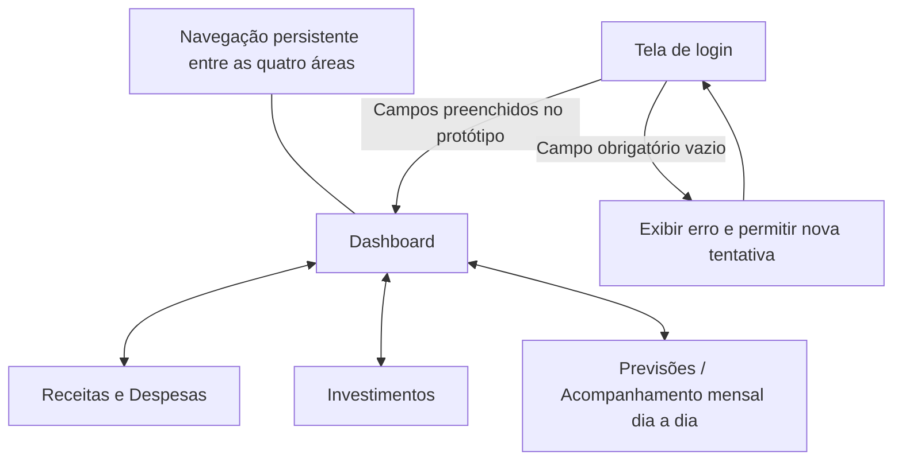

# Fluxo do usuário — BudgetWallet

Documento evolutivo dos percursos, telas, ações e respostas visíveis ao usuário. Atualizar conforme os incrementos alterarem a experiência. As validações e os cálculos são definidos em [Regras de negócio](BUSINESS-RULES.md); prioridades e entregas ficam no [backlog](BACKLOG.md). Fluxos futuros estão identificados e não implicam funcionalidades implementadas.

## Navegação definida

Após o login, o usuário entra no Dashboard. A área principal tem quatro destinos: Dashboard e outras três abas, com Receitas e Despesas reunidas em uma única aba. No primeiro incremento, o acesso é simulado; a autenticação real será implementada posteriormente.



As quatro áreas ficam acessíveis pela navegação principal, inclusive ao sair do Dashboard. O diagrama não exige voltar ao Dashboard para trocar de aba.

## Entrada definida

- Um único campo de texto **E-mail ou username** e um campo **Senha**, com caracteres ocultos.
- Ao preencher os campos e selecionar Entrar, o usuário acessa o Dashboard conforme as regras de acesso demonstrativo em `BUSINESS-RULES.md`.
- Exibir indicação discreta de acesso demonstrativo e orientar o uso de dados fictícios.
- **Criar conta** e **Esqueci minha senha** serão implementados em incremento posterior como modos/formulários da própria página de login. Nesta etapa, não oferecer ações que aparentem funcionar sem implementação.
- Autenticação real, cadastro e recuperação terão seus contratos e regras refinados em BW-09 e BW-11 antes de uso real.

## Responsabilidades propostas para as telas

A estrutura de navegação acima foi definida pelo usuário. O conteúdo abaixo é uma proposta inicial para refinamento, sem antecipar todas as funcionalidades.

| Tela/aba | Objetivo | Conteúdo inicial proposto |
| --- | --- | --- |
| Login | Entrar no Dashboard | E-mail ou username, senha e botão Entrar; acesso demonstrativo no primeiro incremento. Cadastro e recuperação na mesma página em incremento posterior. |
| Dashboard | Entender rapidamente o mês | Mês selecionado, totais de receitas e despesas, resultado mensal, últimas movimentações e atalho para novo lançamento. |
| Receitas e Despesas | Registrar e consultar movimentações | Lista, filtro por mês e tipo, cadastro com tipo, valor, data, categoria e descrição opcional. Edição e exclusão entram em BW-06. |
| Investimentos | Consultar e acompanhar investimentos | Aba prevista; definir primeiro se o foco será aportes ou posição e rentabilidade antes de detalhar campos e modelo. |
| Previsões / Acompanhamento mensal dia a dia | Planejar e acompanhar a evolução do mês | Calendário com receitas previstas, despesas fixas, meta de economia, orçamento diário editável e redistribuição de sobras/excessos. Regras propostas em `BUSINESS-RULES.md`. |

Apresentar valores realizados e previstos separadamente, com rótulos coerentes com os conceitos definidos em `BUSINESS-RULES.md`.

## Esboço de baixa fidelidade

```text
LOGIN
┌──────────────────────────────────────────────┐
│ BudgetWallet                                 │
│ [E-mail ou username]                          │
│ [Senha             ]                          │
│ [Entrar]                                     │
│ Acesso demonstrativo — use dados fictícios    │
│ Mensagem de erro, quando houver               │
└──────────────────────────────────────────────┘

ÁREA PRINCIPAL — DASHBOARD
┌──────────────────────────────────────────────────────────────┐
│ BudgetWallet                                          [Sair] │
│ Dashboard | Receitas e Despesas | Investimentos | Previsões   │
├──────────────────────────────────────────────────────────────┤
│ Dashboard                                  [Mês / Ano]       │
│ [Receitas]          [Despesas]          [Resultado mensal]    │
│                                                              │
│ Últimas movimentações                    [Novo lançamento]   │
│ Data         Descrição         Categoria         Valor       │
│ ...                                                          │
└──────────────────────────────────────────────────────────────┘
```

“Previsões” é apenas um rótulo curto proposto para a navegação; a tela mantém o propósito de acompanhamento mensal dia a dia. A posição e o estilo da navegação serão ajustados ao layout responsivo.

## Primeiro percurso funcional

1. O usuário faz login e chega ao Dashboard.
2. Abre Receitas e Despesas ou usa o atalho de novo lançamento.
3. Escolhe receita ou despesa e preenche valor, data e categoria; descrição é opcional.
4. Ao salvar, recebe confirmação somente após sucesso do servidor e encontra o lançamento na lista.
5. Ao consultar o mesmo mês no Dashboard, vê os totais atualizados.

Os exemplos de cálculo do resultado mensal estão em `BUSINESS-RULES.md`.

Comportamentos esperados:

- No protótipo, campo obrigatório vazio mantém o usuário na tela de entrada com mensagem compreensível; qualquer identificador e senha preenchidos permitem entrar.
- Antes de entrar no protótipo, acessar diretamente uma tela interna leva ao login. Esse controle de navegação não representa autenticação nem proteção de API.
- Sair limpa o estado de acesso demonstrativo e retorna ao login.
- Com autenticação real em BW-09, sessão inválida leva ao login e a API rejeita acesso não autenticado.
- Mês sem lançamentos mostra totais zerados e orientação para cadastrar a primeira movimentação.
- Erro ao salvar mantém o formulário disponível para correção ou nova tentativa, sem indicar sucesso.
- As abas previstas podem aparecer identificadas como “Em breve” no protótipo; não devem simular funcionalidades ou dados reais inexistentes.

## Calendário e planejamento

Fluxo proposto na aba Previsões / Acompanhamento mensal:

1. Selecionar o mês e informar receitas esperadas, despesas fixas com vencimento e meta de economia.
2. Conferir o orçamento disponível para despesas variáveis e a sugestão de valor diário.
3. Ajustar valores de dias específicos, com aviso quando o plano exceder o disponível.
4. Registrar gastos realizados e acompanhar, por dia, orçamento, gasto e diferença.
5. Usar **Redistribuir diferença** para escolher como ajustar os dias futuros, visualizar o resultado e confirmar.

```text
Novembro                         [Configurar mês]
Receita esperada | Fixas previstas | Meta de economia
Orçamento variável restante | Valor ainda não distribuído

Calendário
Dia       Orçamento variável     Gasto variável     Diferença
Hoje      R$ 50,00               R$ 40,00           +R$ 10,00
Amanhã    R$ 50,00               —                  —

[Redistribuir diferença]
  ( ) Dividir igualmente pelos dias restantes
  ( ) Aplicar tudo no próximo dia
  ( ) Escolher dias e valores
  Prévia dos novos valores                    [Confirmar]
```

## Recorte incremental

- **Primeiro incremento:** base executável, estrutura das quatro áreas, acesso demonstrativo com e-mail ou username e senha, e cadastro/listagem de receitas e despesas. O Dashboard começa como tela de entrada; os totais chegam no incremento seguinte.
- **Segundo incremento:** resumo mensal no Dashboard, edição/exclusão e validação do fluxo completo.
- **Incrementos posteriores:** comportamento de Investimentos e acompanhamento diário/previsões, refinados conforme prioridade. A definição das abas não exige criar suas tabelas agora.
- **Acesso real, em incremento posterior:** autenticação por e-mail ou username e senha, cadastro e recuperação na própria página de login. O protótipo local atende ao fluxo demonstrativo, mas não ao aceite de autenticação real de BW-09.

## Encerramento de BW-01

- Categorias iniciais e planejamento mensal aprovados pelo usuário em 17/11/2026. Suas regras estão centralizadas em `BUSINESS-RULES.md`.
- O fluxo e o esboço de baixa fidelidade servem de base à implementação; ajustes visuais e testes de usabilidade permanecem incrementais.

BW-01 está **Concluído** como definição inicial do fluxo e das regras. O aceite foi construído nesta conversa; não representa implementação nem revisão de código por outro integrante. Detalhes operacionais de fechamento do dia, pagamentos parciais e recorrências serão refinados em BW-13/BW-14, sem bloquear a base executável de BW-02.
