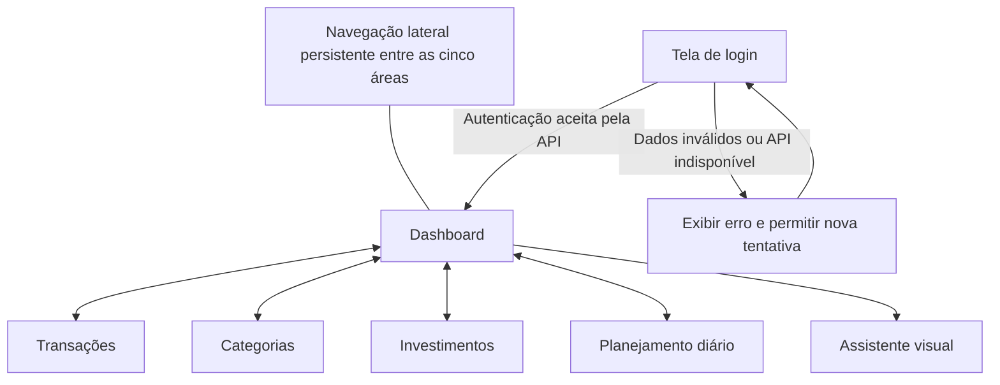

# Fluxo do usuário — BudgetWallet

Documento evolutivo dos percursos, telas, ações e respostas visíveis ao usuário. Atualizar conforme os incrementos alterarem a experiência. As validações e os cálculos são definidos em [Regras de negócio](BUSINESS-RULES.md); prioridades e entregas ficam no [backlog](BACKLOG.md). Fluxos futuros estão identificados e não implicam funcionalidades implementadas.

## Navegação definida

Após entrar, o usuário acessa cinco destinos pela navegação lateral: Dashboard, Transações, Categorias, Investimentos e Planejamento diário. A tela Categorias carrega a lista real da conta pela API protegida e permite criar, editar e excluir categorias personalizadas sem vínculos; Dashboard, Transações, Investimentos e Planejamento diário ainda usam prévias locais.



As cinco áreas ficam acessíveis pela navegação lateral. O botão Assistente abre um painel visual sem integração com IA. Planejamento diário é, por enquanto, uma prévia de interface; cálculo de orçamento e redistribuição continuam pendentes em BW-13/BW-14.

## Entrada definida

- O login recebe **E-mail ou username** e **Senha**, valida os dados pela API e, em caso de sucesso, mantém o JWT na sessão do navegador e abre a área autenticada.
- **Criar conta** recebe nome, e-mail, username, senha e confirmação de senha; a API valida os dados e cria as categorias padrão da conta.
- **Esqueceu a senha?** recebe identificador, senha nova e confirmação. A recuperação atual redefine pelo identificador, sem comprovar posse da conta; essa limitação permanece antes de uso real.
- Erros de validação, credenciais ou conexão são mostrados no formulário. O usuário pode voltar à tela de login.

## Responsabilidades propostas para as telas

A estrutura de navegação acima foi definida pelo usuário. O conteúdo abaixo é uma proposta inicial para refinamento, sem antecipar todas as funcionalidades.

| Tela/aba | Objetivo | Conteúdo inicial proposto |
| --- | --- | --- |
| Login | Entrar no Dashboard | Login, cadastro e recuperação provisória usam rotas da API. O login retorna JWT. A recuperação ainda aceita apenas identificador e senha nova, sem prova de posse da conta; não é segura para uso compartilhado ou real. |
| Dashboard | Entender rapidamente o mês | Resumo local de receitas, despesas e resultado do período, despesas por categoria, últimos lançamentos e carteira estimada. Os atalhos levam aos painéis correspondentes; os dados aguardam integração com a API. |
| Transações | Registrar e consultar movimentações | Prévia local com resumo mensal, busca, filtros por tipo, lista por data e painel de detalhes do lançamento selecionado. Criação, edição, exclusão e dados da conta aguardam integração com a API. O período vem do seletor global no topo. |
| Categorias | Organizar classificações | Carrega as categorias da conta pela API e abre um modal para criar categorias principais ou subcategorias. O lápis abre o formulário preenchido para edição. A lixeira abre uma confirmação ou informa que existem subcategorias, transações ou investimentos vinculados; só categorias personalizadas sem vínculos podem ser excluídas nesta etapa. Busca e filtros funcionam localmente. |
| Investimentos | Consultar e acompanhar investimentos | Prévia local com resumo da carteira, evolução estimada e lista de aportes. Selecionar um item abre seus dados e o progresso do prazo; comparação de projeções fica para incremento posterior. Criação, edição, exclusão e dados da conta aguardam integração com a API. |
| Planejamento diário | Planejar e acompanhar a evolução do mês | Prévia local com calendário, receita prevista, despesas fixas, meta para guardar, orçamento diário e resumo do dia selecionado. Edição e redistribuição ainda aguardam definição completa das regras e integração. Consulte `BUSINESS-RULES.md`. |

Apresentar valores realizados e previstos separadamente, com rótulos coerentes com os conceitos definidos em `BUSINESS-RULES.md`. As prévias atuais não devem ser confundidas com dados persistidos ou cálculos integrados.

## Esboço de baixa fidelidade

```text
LOGIN
┌──────────────────────────────────────────────┐
│ BudgetWallet                                 │
│ [E-mail ou username]                          │
│ [Senha             ]                          │
│ [Entrar]                                     │
│ [Criar conta] [Esqueceu a senha?]             │
│ Mensagem de erro, quando houver               │
└──────────────────────────────────────────────┘

ÁREA PRINCIPAL — ESBOÇO HISTÓRICO DO PRIMEIRO FLUXO
┌──────────────────────────────────────────────────────────────┐
│ BudgetWallet                                          [Sair] │
│ Dashboard | Receitas e Despesas | Investimentos | Previsões   │
├──────────────────────────────────────────────────────────────┤
│ Dashboard                                  [Mês / Ano]       │
│ [Receitas]          [Despesas]          [Resultado mensal]    │
│                                                              │
│ Últimas movimentações                    [Novo lançamento]   │
│ Data         Descrição         Categoria         Valor       │
│ ...                                                          │
└──────────────────────────────────────────────────────────────┘
```

O esboço acima antecede a interface implementada e conserva uma referência visual simplificada. A navegação atual usa menu lateral e inclui os cinco destinos descritos. A versão com painéis distribuídos foi aplicada à página de login React; veja [Direção visual do login](LOGIN-DESIGN.md). A área autenticada usa a paleta azul e o painel visual do assistente.

## Fluxo financeiro planejado — ainda não integrado

1. O usuário faz login e chega ao Dashboard.
2. Abre Receitas e Despesas ou usa o atalho de novo lançamento.
3. Escolhe receita ou despesa e preenche valor, data e categoria; descrição é opcional.
4. Ao salvar, recebe confirmação somente após sucesso do servidor e encontra o lançamento na lista.
5. Ao consultar o mesmo mês no Dashboard, vê os totais atualizados.

Os exemplos de cálculo do resultado mensal estão em `BUSINESS-RULES.md`.

Este é o fluxo de produto esperado para BW-04/05/06, não um fluxo já entregue. As telas atuais são demonstrações locais.

Comportamentos esperados após a integração:

- Login, cadastro e recuperação fazem chamadas às rotas de autenticação. Credenciais inválidas e erros da API são apresentados ao usuário.
- Após login válido, o JWT fica na sessão do navegador. A tela Categorias usa o token na listagem protegida; as demais telas financeiras ainda não têm rotas integradas.
- Sair limpa a sessão e retorna ao login.
- O middleware JWT protege a listagem de categorias e impede acesso a outro usuário. As demais rotas financeiras ainda não existem; a proteção abrangente e os testes de isolamento seguem pendentes em BW-09.
- Mês sem lançamentos mostra totais zerados e orientação para cadastrar a primeira movimentação.
- Erro ao salvar mantém o formulário disponível para correção ou nova tentativa, sem indicar sucesso.
- A navegação autenticada ainda não implementa operações financeiras; ações desabilitadas e dados de exemplo indicam que a integração está pendente.

## Calendário e planejamento

Prévia visual na aba Planejamento diário. O calendário e os valores são locais; este fluxo de produto ainda depende do refinamento e da implementação de BW-13/BW-14:

1. Selecionar o mês e informar receitas esperadas, despesas fixas com vencimento e meta de economia.
2. Conferir o orçamento disponível para despesas variáveis e a sugestão de valor diário.
3. Ajustar valores de dias específicos, com aviso quando o plano exceder o disponível.
4. Registrar gastos realizados e acompanhar, por dia, orçamento, gasto e diferença.
5. Usar **Redistribuir diferença** para escolher como ajustar os dias futuros, visualizar o resultado e confirmar.

```text
Novembro                         [Configurar mês]
Receita esperada | Fixas previstas | Meta de economia
Orçamento variável restante | Valor ainda não distribuído

Calendário
Dia       Orçamento variável     Gasto variável     Diferença
Hoje      R$ 50,00               R$ 40,00           +R$ 10,00
Amanhã    R$ 50,00               —                  —

[Redistribuir diferença]
  ( ) Dividir igualmente pelos dias restantes
  ( ) Aplicar tudo no próximo dia
  ( ) Escolher dias e valores
  Prévia dos novos valores                    [Confirmar]
```

## Estado do front e próximos incrementos

- O front tem navegação para cinco áreas, prévias locais dos painéis financeiros e interações visuais de busca, filtros, seleção e calendário.
- Cadastro e login chamam a API e o cadastro cria categorias padrão. A recuperação por identificador está implementada apenas como fluxo provisório de desenvolvimento.
- BW-04 a BW-06 seguem pendentes: criar rotas financeiras, integrar transações e persistir consultas, correções e exclusões.
- BW-12 está parcial: criação, edição e exclusão de categorias sem vínculos usam a API; arquivamento e reclassificação antes de excluir categorias em uso ainda estão pendentes.
- BW-13/BW-14 seguem pendentes de regras finais e implementação persistente; a prévia de Planejamento diário não os conclui.
- BW-09 segue parcial: falta validação de JWT em rotas protegidas, autorização e testes de isolamento por proprietário; recuperar senha requer prova de posse da conta antes de uso real.

O protótipo visual foi concluído intencionalmente para avaliação dos stakeholders antes da integração com o backend. Na revisão visual independente de 24/11/2026, a direção geral foi aprovada. Como insumos para decisões futuras de produto e refinamento visual, foram anotados: representar valores negativos abaixo da linha zero no gráfico de resultado, avaliar um resumo de Planejamento diário na Dashboard e agrupar categorias excedentes da pizza em “Outras”. Esses pontos não bloqueiam a avaliação do protótipo nem substituem a integração posterior dos dados reais.

## Encerramento de BW-01

- Categorias iniciais e planejamento mensal aprovados pelo usuário em 17/11/2026. Suas regras estão centralizadas em `BUSINESS-RULES.md`.
- O fluxo e o esboço de baixa fidelidade servem de base à implementação; ajustes visuais e testes de usabilidade permanecem incrementais.

BW-01 está **Concluído** como definição inicial do fluxo e das regras. O aceite foi construído nesta conversa; não representa implementação nem revisão de código por outro integrante. Detalhes operacionais de fechamento do dia, pagamentos parciais e recorrências serão refinados em BW-13/BW-14, sem bloquear as ferramentas locais de BW-02 ou as classes, ORM e testes de BW-03. BW-15 está em andamento e já entregou o esqueleto visual e a integração das rotas de autenticação; os fluxos financeiros seguem para implementação vertical conforme o backlog.
